# planescapeRAG

End-to-end pipeline that turns a stack of scanned RPG sourcebooks into a queryable, cited entity graph with a graph-augmented retrieval (graphRAG) chat UI.

The current build has ingested **27 TSR Planescape products** (boxed sets, accessories, and adventure modules) into **4,188 entities** across seven supertypes (characters, places, planes, creatures, factions, items, concepts). Each entity has typed relationships, verbatim source quotes, and page-level citations, and is indexed as **12,222 per-source-section vectors** for retrieval.

## What it does

1. **OCR** scanned PDFs into clean markdown using GPT-4o vision via the OpenAI Batch API.
2. **Extract** entities and their relationships from that markdown using Claude with tool use (structured output).
3. **Reconcile** entities across multiple sourcebooks into one global graph. The same entity from different books gets one file with per-source sections.
4. **Type the edges**: a classification pass assigns each relationship a predicate (`RULER_OF`, `LOCATED_IN`, `MEMBER_OF`, …) from a closed, schema-enforced vocabulary.
5. **Embed + retrieve**: each entity's source sections are embedded and searched with FAISS, then expanded 1 hop along the wikilink graph in both directions (forward and reverse).
6. **Answer** natural-language questions with Claude, grounded in retrieved text, with inline `(source, p. N)` citations.

## Architecture

```mermaid
flowchart LR
    subgraph INGEST["Offline ingest &mdash; run_pipeline.py / tools/batch_pipeline.py"]
        direction TB
        PDF[/"Scanned PDFs<br/>documents/"/] --> OCR["1 &middot; OCR<br/>pdf2image &rarr; S3 presigned URLs<br/>&rarr; GPT-4o vision (Batch API)"]
        PROFILE[/"Corpus profile<br/>corpus_profiles/*.md<br/>OCR rules + corrections"/] -.-> OCR
        OCR --> MD[("ocr/&lt;doc_tag&gt;.md<br/>page-marked markdown")]
        MD --> P1["2 &middot; Pass 1: registry<br/>Claude tool use"]
        P1 --> DEDUP["3 &middot; Dedup"] --> MERGE["4 &middot; Merge into global<br/>fuzzy matches &rarr; LLM verifier"]
        MERGE --> SWEEP["5 &middot; Completeness sweep<br/>LLM: what's missing?"]
        SWEEP --> HEUR["6 &middot; Heuristic candidates<br/>regex + LLM verifier"]
        HEUR --> CANON["7 &middot; Canonicalize types"]
        CANON --> REG[("graph/registry.json<br/>global entity registry")]
        REG --> P2["8&ndash;9 &middot; Pass 2: profiles<br/>Anthropic Batches<br/>Sonnet (notable) / Haiku (minor)<br/>windowed local registry"]
        MD --> P2
        P2 --> VAL{"Quote validator<br/>substring &middot; Unicode fold &middot; fuzzy"}
        VAL --> ENT[("graph/entities/&lt;type&gt;/*.md<br/>per-source sections + [[wikilinks]]")]
        ENT --> PRED["Predicate classification<br/>closed vocab, enum-enforced"]
        PRED --> ENT
        ENT --> EMB["10 &middot; Embed sections<br/>text-embedding-3-small<br/>incremental by sha256"]
        EMB --> IDX[("chatbot/index/<br/>vectors.npy + metadata.json")]
        ENT -.-> NEO["tools/load_neo4j.py<br/>(sketch) typed property graph"]
        NEO -.-> NEODB[("Neo4j")]
    end

    subgraph QUERY["Online query &mdash; chatbot/ (FastAPI + HTMX)"]
        direction TB
        Q(["User question"]) --> QE["Embed query"]
        QE --> KNN["FAISS top-k<br/>dedupe to best section per entity"]
        KNN --> FWD["Forward 1-hop<br/>wikilinks out of primaries"]
        KNN --> REV["Reverse 1-hop<br/>entities that link in"]
        FWD --> CTX["Context set<br/>primaries + expansions (&le;15)"]
        REV --> CTX
        CTX --> LLM["Claude answer<br/>Haiku / Sonnet / Opus<br/>strict citation rules"]
        LLM --> UI["Answer HTML<br/>clickable [[wikilinks]] + (doc, p. N)"]
        CTX --> VIS["pyvis subgraph<br/>/graph/{id}"]
        UI -.-> PAGE["Source-page viewer<br/>/page/{doc}/{p}"]
    end

    IDX --> KNN
    ENT --> FWD
    ENT --> REV
    PDF -.-> PAGE
    COST[("cost_log.jsonl<br/>per-call USD ledger")]
    INGEST -.-> COST
    LLM -.-> COST
```



### Ingest pipeline

Ten stages, orchestrated by [run_pipeline.py](run_pipeline.py). Each stage's outputs are checkpointed. `--start-from <stage>` resumes mid-run, and `--stop-after <stage>` stops early. Stage modules live in [pipeline/](pipeline/).

| # | Stage | What it does | Tech |
|---|---|---|---|
| 1 | **`ocr`** | Chunk PDF → batch JSONL → S3 presigned URLs → GPT-4o vision → combined markdown with `<!-- page N -->` markers. Tier-1 token caps respected; partial runs resume. | `pdf2image`, `boto3`, OpenAI Batch API |
| 2 | **`registry`** (pass 1) | Single Claude call extracts every entity into a typed registry (canonical name, type, aliases, brief description, notable flag). Tool use enforces schema. | Anthropic SDK + tool use |
| 3 | **`dedup`** | Merges canonical-name and alias duplicates within the per-doc registry (case-insensitive, leading-"the" insensitive). | in-memory |
| 4 | **`merge`** | Folds the per-doc registry into the global one. Exact matches merge silently; fuzzy matches go to an LLM verifier (`Frey` vs `Freya` are different deities; `the Lady of Pain` and `Lady of Pain` are not). | Anthropic SDK |
| 5 | **`sweep`** | Gives the model the full doc + a slim, doc-relevant registry, asks "what's mentioned but not registered?" Suggestions are substring-validated against the source before being added. | Anthropic SDK |
| 6 | **`heuristic`** | Regex-finds proper-noun spans the LLM missed (high-frequency cosmological terms like *Outer Planes*, *Hive Ward*, *Toril* that the LLM systematically biased away from). An LLM verifier decides skip / merge_into / add_new. | `regex` + Anthropic SDK |
| 7 | **`canonicalize`** | Maps freeform types ("demipower", "proxy", "petitioner") to a small supertype set ("character", "creature"…) over the global registry. | Anthropic SDK |
| 8 | **`profiles_submit`** (pass 2) | For each entity, builds a windowed local-registry slice and submits a batch request asking Claude to write a structured profile (description with `[[wikilinks]]`, source pages, relationships with verbatim quotes). **Two-tier routing:** notable entities go to Sonnet, minor ones to Haiku (~3× cheaper). | Anthropic Batches |
| 9 | **`profiles_collect`** | Polls the batch, validates each profile's quotes (substring + Unicode fold + fuzzy regex against the source), then upserts a `## Source: <doc_tag>` section into the entity's markdown file. | Anthropic Batches + custom validator |
| 10 | **`embed`** | Embeds each entity's `## Source:` sections with `text-embedding-3-small` into `vectors.npy` + `metadata.json`. Incremental: only re-embeds changed content. | OpenAI embeddings, NumPy |

**Multi-document batching.** [tools/batch_pipeline.py](tools/batch_pipeline.py) runs the corpus in two phases. Phase 1 overlaps OCR for doc *N+1* with stages 2–7 for doc *N* (producer/consumer; registry stages stay serial because they mutate the shared registry). Phase 2 runs pass 2 for every doc only after the registry holds *every* doc's entities, so wikilinks written for early books resolve to entities introduced by later ones.

**Post-processing passes** (run after ingest):
- [pipeline/classify_predicates.py](pipeline/classify_predicates.py) assigns each relationship bullet one of 19 predicates plus a `_NO_EDGE` escape, and a direction. The vocabulary is enum-enforced through the tool schema so the model can't drift. The vocabulary came from a regex survey of the actual quotes ([tools/predicate_scan.py](tools/predicate_scan.py) → [tools/predicates.yaml](tools/predicates.yaml)).
- [tools/find_degenerate_entities.py](tools/find_degenerate_entities.py) flags OCR noise registered as entities (stat-block tokens, class abbreviations, numeric names). [tools/apply_decisions.py](tools/apply_decisions.py) applies a reviewed YAML of merges, renames, deletions, and type changes idempotently, backing up the registry first.

### Entity format

The output is a directory of markdown files, one per entity, sharded by supertype:

```markdown
---
canonical_name: "Abriymoch"
type: "place"
supertype: "place"
source_documents: ["campaign_setting", "planes_of_law"]
source_pages: {"planes_of_conflict": [288], "inner_planes": [32], "campaign_setting": [54], "planes_of_law": [123]}
---

# Abriymoch

## Source: inner_planes
Abriymoch is a city located in Phlegethos, the fourth layer of Baator. … The pit fiend
ruler of Abriymoch maintains this portal … with [[Ogremoch]], the Prince of Evil Earth Elementals …

### Relationships from inner_planes
- LOCATED_IN → [[Phlegethos]] — "It lies in Phlegethos, the fourth layer, near the center of the city called Abriymoch" (p. 32)
- PORTAL_TO → [[Stonemire]] — "it provides convenient passage between Baator and the evil fortress of Stonemire" (p. 32)
- ← LOCATED_IN [[Baator]] — "The dismal depths of Baator hold another well-documented portal to Earth. …" (p. 32)

## Source: planes_of_conflict
…
```

`PRED → [[X]]` means *this entity* PRED *X*, and `← PRED [[X]]` means *X* PRED *this entity*. The wikilinks make the markdown corpus a graph today. [tools/load_neo4j.py](tools/load_neo4j.py) is an early sketch of loading it into Neo4j as a typed property graph: `:Entity` plus a type label on each node, one relationship type per predicate, and quote, page, and source doc as edge properties.

## Chat UI ([chatbot/](chatbot/))

- **FastAPI** serves both the HTML UI and a JSON `/query` API (see [chatbot/api.py](chatbot/api.py)): `/`, `/chat`, `/entity/{id}`, `/graph/{retrieval_id}`, `/page/{doc_tag}/{page}`, `/query`, `/capabilities`, `/health`.
- **HTMX** drives the front-end with no SPA framework. Submitting a question swaps a fragment into `#answer-panel`, and clicking a wikilink loads that entity's dossier into `#entity-panel`. `hx-push-url` makes back/forward work.
- **pyvis** renders an interactive force-directed graph of the retrieved subgraph.
- **Source-page viewer** (gated by `PLANESCAPE_SHOW_PAGES=1`): `(doc_tag, p. N)` citations link to the rendered PDF page, closing the loop from generated answer back to the original scan.

### Retrieval ([chatbot/retrieve.py](chatbot/retrieve.py))

1. **Per-section vector search.** Each `## Source: <doc>` section is its own vector, so a 20-source hub entity like Sigil doesn't get averaged into mush. Results are deduped to the best-matching section per entity (top-k = 5), and only that section goes into the prompt.
2. **Forward 1-hop.** The retriever follows wikilinks out of each primary's *full* body and ranks targets by inbound-link count (capped at 50), favoring hubs over leaf NPCs.
3. **Reverse 1-hop.** It also pulls in entities whose bodies link *to* a primary or forward expansion. This step surfaces members, residents, and rulers that the primary's own text never names.
4. **Budgeting.** Forward and reverse expansion split the budget (≤15 entities total) round-robin across sources, so one link-rich primary can't starve the others.

The expansion step is what makes this graphRAG and not flat RAG. *"Who governs the city of Abriymoch?"* embeds strongly to **Abriymoch** (0.61), but Abriymoch's own sections only say "ruled by a pit fiend." The name lives on **Gazra**, whose profile links to `[[Abriymoch]]`. Reverse expansion pulls Gazra into context even though it isn't in the vector top-5.

## Notable engineering decisions

- **Two-pass extraction.** Pass 1 only commits to a registry of names + types. Pass 2 writes the full per-entity profile, so relationships can use `[[wikilinks]]` that *will resolve*. The registry is the contract between passes.
- **Per-source sections, not synthesized profiles.** When the same entity appears in many sourcebooks, its file gets one `## Source: …` section per book rather than one merged description. This avoids "synthesize across sources" hallucination, makes ingest incremental (a new book only profiles entities it mentions), keeps every quote attributable, and gives retrieval a natural chunk boundary.
- **Local registry over global registry in pass 2.** The initial design sent the full global registry (~75K tokens) as a cached prefix. Anthropic's batch workers all hit the cache before any could populate it, so every request paid the cache-*write* rate. The fix sends a per-entity windowed slice (~0.5–3K tokens) with no `cache_control`. As a side benefit, the architecture now scales to arbitrarily large registries.
- **Model routing by notability.** Pass 1 already flags entities as notable or not. Pass 2 sends notable entities to Sonnet and the long tail to Haiku, cutting pass-2 cost substantially with little quality loss on one-paragraph NPCs.
- **Closed predicate vocabulary.** Relationship types were derived empirically (regex scan of thousands of quotes → proposed vocabulary → human review) and then enforced via a tool-schema enum, with an explicit `_NO_EDGE` escape so the model isn't forced to invent an edge.
- **Corpus profiles as a portability seam.** All Planescape-specific quirks (decorative-font OCR rules, pull-quote conventions, OCR mis-transcriptions) live in [corpus_profiles/](corpus_profiles/). The pipeline core is corpus-agnostic, so pointing it at a different scanned corpus means writing a new profile, not changing code.
- **OCR corrections are applied in-memory at ingest time, not baked into the OCR output.** A profile's `### OCR corrections` section lists rules like `Caviitus → Cavitius`. The original OCR stays on disk unchanged, and the corrections apply whenever a downstream stage loads the doc.
- **Layered quote validation.** Strict substring matching dropped ~330 quotes per run on the Campaign Setting. A Unicode-punctuation fold, a fuzzy regex anchored on first and last words, and handling for `[[Target|Display]]` wikilinks recovered ~210 of them.
- **Cost tracking is first-class.** [cost.py](cost.py) keeps a JSONL ledger of per-call model, usage, and USD, runs pre-flight batch estimates that prompt for confirmation above a threshold, and de-dupes re-collected batches so the ledger stays honest.

For the longer war stories (non-determinism in vision OCR, decorative typography, the cache-write surprise, the $200 lesson), see [Learnings.md](Learnings.md). Full dependency rationale is in [techstack.md](techstack.md).

## Layout

```
planescapeRAG/
├── run_pipeline.py          ← 10-stage orchestrator (--start-from / --stop-after)
├── config.py                ← env-driven Settings dataclass
├── cost.py                  ← pricing tables, ledger, pre-flight estimates
├── pipeline/                ← one module per stage
│   ├── ocr.py, submit_batches.py, combine_batch.py         (stage 1)
│   ├── extract_registry.py, dedup_registry.py              (stages 2–3)
│   ├── merge_registries.py, verify_fuzzy_merges.py         (stage 4)
│   ├── completeness_sweep.py                               (stage 5)
│   ├── heuristic_entity_candidates.py, verify_candidates.py (stage 6)
│   ├── canonicalize_types.py                               (stage 7)
│   ├── extract_profiles.py                                 (stages 8–9)
│   └── classify_predicates.py                              (post-pass)
├── tools/                   ← batch orchestration, cleanup, analysis
│   ├── batch_pipeline.py        two-phase multi-doc ingest
│   ├── apply_decisions.py       + cleanup_decisions.yaml
│   ├── find_degenerate_entities.py, merge_case_variants.py, strip_empty_sections.py
│   ├── predicate_scan.py        + predicates.yaml
│   ├── refresh_entity_frontmatter.py, verify_canonical_names.py
│   ├── cost_summary.py, estimate_phase2.py
│   └── load_neo4j.py            (sketch)
├── corpus_profiles/         ← per-corpus OCR/ingest rules + corrections
├── ocr/<doc_tag>.md         ← OCR'd, page-marked markdown (27 docs)
├── graph/
│   ├── registry.json                    ← global entity registry
│   ├── type_supertype_mapping.json
│   └── entities/<supertype>/<slug>.md   ← 4,188 entity files
└── chatbot/
    ├── api.py               ← FastAPI: HTML UI + JSON API
    ├── retrieve.py          ← per-section FAISS + forward/reverse 1-hop expansion
    ├── answer.py            ← Claude with strict citation system prompt
    ├── embed_entities.py    ← incremental per-section embedding builder
    ├── render.py            ← markdown → HTML, wikilink/citation linkifier, pyvis
    ├── doc_sources.json     ← doc_tag → PDF path / title
    ├── index/               ← vectors.npy + metadata.json
    ├── templates/           ← Jinja2 (HTMX fragments)
    └── static/style.css
```

## Setup

### Conda environment

```bash
conda env create -f ../environment.yml      # first time
conda activate graphRAG
python -m pip install -r requirements.txt
```

`direnv` users can `direnv allow` from the workspace root to auto-activate.

### System dependency (PDF rendering)

```bash
sudo apt install poppler-utils    # Ubuntu/Debian
brew install poppler              # macOS
```

### Environment variables (`planescapeRAG/.env`)

```bash
OPENAI_API_KEY=...
ANTHROPIC_API_KEY=...
S3_OCR_BUCKET=...
AWS_ACCESS_KEY_ID=...
AWS_SECRET_ACCESS_KEY=...
OPENAI_OCR_MODEL=gpt-4o     # optional, default
NEO4J_USER=... / NEO4J_PASSWORD=...   # only for tools/load_neo4j.py
```

OCR uploads each page image to S3 and gives OpenAI a 24h presigned URL, so the bucket needs to allow object reads via presigned URL. The chatbot alone only needs the OpenAI and Anthropic keys.

## Usage

### Ingest a sourcebook end-to-end

```bash
python -m planescapeRAG.run_pipeline \
    --pdf "documents/Boxed Sets/TSR 2600 Planescape Campaign Setting.pdf" \
    --profile corpus_profiles/planescape_tsr.md \
    --doc-tag campaign_setting
```

Resume from any stage:

```bash
python -m planescapeRAG.run_pipeline ... --start-from profiles_submit
```

Batch-ingest many docs (see the module docstring for flags):

```bash
python -m planescapeRAG.tools.batch_pipeline --phase all
```

### Run the chatbot

```bash
cd chatbot
make run
# → http://localhost:8000        (UI)
# → http://localhost:8000/docs   (Swagger for the JSON API)
```

Query the retriever from the CLI (no LLM call):

```bash
python -m planescapeRAG.chatbot.retrieve "Who governs the city of Abriymoch?"
```

Re-embed after ingesting a new doc:

```bash
make embed
```

## Status

- **Done:** OCR pipeline, two-pass entity extraction with Sonnet/Haiku routing, cross-doc merge with LLM verifier, completeness sweep, heuristic candidate fill-in, type canonicalization, quote validation, predicate classification, cleanup tooling, per-section embeddings, forward + reverse graph expansion, FastAPI/HTMX chat UI with cited answers, pyvis graph view, source-page viewer, cost tracking.
- **Ingested:** 27 Planescape products → 4,188 entities.
- **Next:** a retrieval eval set (question → expected entity, recall@k); predicate-aware retrieval (e.g. prefer `RULER_OF` edges for "who rules X?"); finish and verify the Neo4j loader. See [TODO.md](TODO.md).
